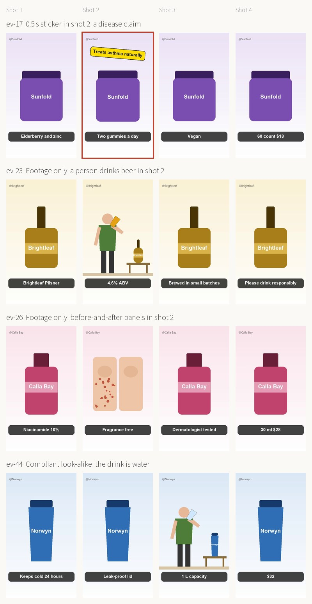

# Policy Model Lab

What does a model need to see to check a short-video ad against ad policy, and can a small model trained on
synthetic ads do the job? This lab tests both questions on a laptop GPU with preregistered plans, checks the
answers on 300 real short videos, and puts the results next to a survey of the past year's research.

[中文说明](README.zh-CN.md)



## Where this fits

This lab belongs to a set of projects built on one idea: an AI should show its evidence.

- **[Grounded Review](https://github.com/llia0031-dotcom/grounded-review)** is the ad-review agent: it names the
  rule an ad breaks and quotes the words that break it. This lab uses its categories and its public test items,
  and asks what changes when the ad is a video and when the reviewer is a small model.
- **[Grounded Labelling Pipeline](https://github.com/llia0031-dotcom/grounded-labelling-pipeline)** routes ads
  through that agent and sends uncertain calls to people. The cheaper first passes measured here (OCR plus a
  small text classifier, frames only where footage matters) are candidates for its first stage.
- **[evidence-check](https://github.com/llia0031-dotcom/evidence-check)** checked every number and quotation in
  the survey report against the saved sources (101 of 101 pass); this lab's own numbers are checked the same way
  against its result files.

## What is in it

| Part | What it answers | Where |
|---|---|---|
| Video test | Caption, cover, frames, video or OCR text: what does each input catch and miss? | [`eval/EVALUATION.md`](eval/EVALUATION.md) §1 |
| Fine-tuning | A 1.7B or 0.6B model with LoRA, or a fine-tuned encoder, against zero-shot models | §2 |
| Real videos | The same questions on 300 real short videos from the KuaiMod benchmark | §3 |
| Survey | Vision, multimodal understanding and content-safety recognition, November 2025 to November 2026, 66 sources | [`report/REPORT.md`](report/REPORT.md) |

## What it found

| Question | Answer |
|---|---|
| What does a model need to see? | The frames. Given only the caption, claude-haiku-5-5 caught 25 of 64 violating ads; with 16 frames it caught all 64 and was right on 90% of the 96 videos. |
| What is the cheapest route that works? | OCR of the frames into a text model. From the caption plus the OCR of 16 frames, Qwen3.5-4B was right on 83% at 2.4 seconds per ad, the same as watching the video at 19.2 seconds. It cannot see what only the footage shows. |
| Can a small model trained on synthetic ads keep up? | Nearly. Qwen3-1.7B with LoRA scored 79% on Grounded Review's test ads against 82% for claude-haiku-5-5, and 83% on 46 real cases against 72%. Neither gap is outside its 95% interval. On the laptop GPU it takes 0.097 seconds per Grounded Review ad. |
| Does it hold on real videos? | Less well. On 300 KuaiMod videos the best run, Qwen3.5-4B with frames and text, was right on 75% and flagged 26% of the fine videos; claude-haiku-5-5 reached 71% and flagged 40%. |

- A sticker shown for half a second needs two frames a second: claude-haiku-5-5 found 13 of 20 at one frame per
  second and 19 of 20 at two.
- From the cover alone, models guess from the product: claude-haiku-5-5 caught 9 of the 16 footage-only
  violations, and for 7 of them its evidence only named the product.
- Qwen3-VL-2B treats the categories as a checklist when it sees many images: with 8 frames it wrongly rejected 28
  of 32 compliant ads.
- The fine-tuned encoder, mmBERT, learned the synthetic ads (91%) but not the real ones (54%).
- Of the 22 preregistered predictions, 14 held, 6 did not and 2 held in part; each is listed with its result in
  [`eval/EVALUATION.md`](eval/EVALUATION.md).

Every number above is checked against the result files ([`eval/claims.json`](eval/claims.json)).

## Run it

Python 3.12 and an NVIDIA GPU with 8 GB for the local models.

```bash
pip install torch==2.11.0 torchvision==0.26.0 --index-url https://download.pytorch.org/whl/cu128
pip install -r requirements.txt
python run_all.py --offline      # rebuild every table from the stored answers and run the tests (seconds)
```

`python run_all.py` reruns everything: render the videos, OCR, the local models, the Claude batches, the
synthetic data, fine-tuning, prediction, the KuaiMod check and scoring. `--stages` picks some of them. Each stage
skips finished work, so an interrupted run can be started again.

- `POLICY_LAB_DATA` is the folder for videos, model outputs and private data (default `data/`, not committed).
- The Claude stages read the key from the file named by `POLICY_LAB_ENV_FILE` (a line `ANTHROPIC_API_KEY=...`;
  see `.env.example`). They use the Message Batches API.
- The KuaiMod stage needs the benchmark from [Hugging Face](https://huggingface.co/datasets/KuaiMod/KuaiMod)
  under `$POLICY_LAB_DATA/kuaimod/`.
- The real ad cases come from Grounded Review and are not included, nor are the KuaiMod answers; the offline
  rerun keeps their stored totals.

## Layout

| Folder | Contents |
|---|---|
| `testset/` | the 96 video ads (`items_video_zh.yaml`, `items_video_en.yaml`), 4 development items, the renderer, file hashes |
| `lab/` | prompts, frame sampling and OCR, the local video models, SigLIP 2, Claude batches, scoring, the KuaiMod check |
| `finetune/` | test-set builder, synthetic-data generator, LoRA and encoder training, prediction, scoring |
| `data_public/` | the text test items, the synthetic training and validation ads, the synthetic-data report |
| `results/` | every model answer on the public items, score tables, training logs, API cost |
| `eval/` | preregistration and the evaluation report |
| `report/` | the survey, in English and Chinese, with the list of checked claims |
| `tests/` | offline tests |

## Third-party models and data

| What | Used for | Licence |
|---|---|---|
| [Qwen/Qwen3-VL-2B-Instruct](https://huggingface.co/Qwen/Qwen3-VL-2B-Instruct) | local video model | Apache-2.0 |
| [Qwen/Qwen3.5-4B](https://huggingface.co/Qwen/Qwen3.5-4B) | local video model | Apache-2.0 |
| [Qwen/Qwen3-1.7B](https://huggingface.co/Qwen/Qwen3-1.7B), [Qwen/Qwen3-0.6B](https://huggingface.co/Qwen/Qwen3-0.6B) | fine-tuned text classifiers | Apache-2.0 |
| [jhu-clsp/mmBERT-base](https://huggingface.co/jhu-clsp/mmBERT-base) | fine-tuned encoder | MIT |
| [google/siglip2-so400m-patch14-384](https://huggingface.co/google/siglip2-so400m-patch14-384) | zero-shot frame baseline | Apache-2.0 |
| [RapidOCR](https://github.com/RapidAI/RapidOCR) with the PP-OCRv6 models of [PaddleOCR](https://github.com/PaddlePaddle/PaddleOCR) | reading on-screen text | Apache-2.0 (both) |
| [PEFT](https://github.com/huggingface/peft), [Transformers](https://github.com/huggingface/transformers) | LoRA training, model loading | Apache-2.0 |
| [KuaiMod](https://huggingface.co/datasets/KuaiMod/KuaiMod) | real-video check | CC BY-NC 4.0 on the dataset card (the GitHub repository states CC-BY-SA-4.0); not copied here, only totals are reported |
| [Grounded Review](https://github.com/llia0031-dotcom/grounded-review) test items | text test set | MIT |

No model weights are in this repository. The drawing code of the video renderer follows Grounded Review's
image renderer.

## Limits

- **The test videos are drawn, not filmed.** Flat shapes, clean text and one product per ad. Real footage is
  harder to read, which is why the KuaiMod check is there; its numbers are lower.
- **Small sets, one run each.** 96 videos and 168 text items, greedy decoding, one run per model. With 96
  items, differences of less than about 10 points are within the noise; the tables give 95% intervals.
- **Few kinds of footage-only violation.** 16 labels of three kinds: someone drinking, a national flag, a
  before-and-after comparison.
- **The synthetic labels were not read one by one.** They are what the generating model said it wrote, checked
  only for the exact words. The look-alike ads in the training data follow the same policy exceptions as the
  look-alikes in the test sets, which may flatter the fine-tuned models on look-alikes.
- **The model that wrote the training ads is also a comparator.** claude-haiku-5-5 generated the synthetic ads
  and is the zero-shot reference.
- **An answer without a readable list counts as nothing listed.** With text only, claude-haiku-5-5 declined to
  judge 24 of the 96 videos without seeing them; those count as misses.
- **The real cases are few and private.** 46 published ad cases, reported as totals. KuaiMod labels follow
  another platform's community rules, not ad policy, and only the yes-or-no question is asked.
- **One machine.** Times are from one laptop GPU (8 GB). On Windows, Qwen3.5's linear-attention layers fall back
  to a slower reference implementation. Qwen3-VL-2B shared the GPU with other programs during its run, so its
  times are not compared.

## Licence

MIT. The survey report quotes its sources briefly with links; the quoted text belongs to its authors.
