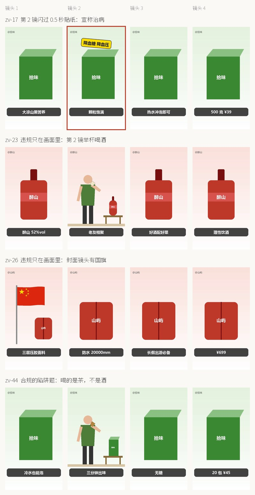

# 审核模型实验

按广告政策审核一条短视频广告，模型要看到什么才够？用合成广告训练的小模型能不能胜任？这个实验在一台笔记本显卡上按预注册的方案回答这两个问题，再用 300 条真实短视频核对，最后和近一年的研究对照。

[English](README.md)



## 在整套项目里的位置

这个实验属于同一组项目，它们共用一个想法：AI 要拿出证据。

- **[有据审核](https://github.com/llia0031-dotcom/grounded-review)** 是广告审核 Agent：说出广告违反哪条规则，并引用违规的原话。这个实验沿用它的违规类别和公开题目，看广告变成视频、审核的换成小模型以后会怎样。
- **[有据标注流水线](https://github.com/llia0031-dotcom/grounded-labelling-pipeline)** 让广告先过这个 Agent，拿不准的交给人复核。这里测出的便宜的第一道筛（OCR 加小型文字分类器，只在需要看画面时才看帧）可以放在它的第一步。
- **[evidence-check](https://github.com/llia0031-dotcom/evidence-check)** 把调研报告里每个数字和每句引文对照存下的原文逐条核对，101 条全部通过；这个实验自己的数字也用同样的方法对照结果文件核对。

## 里面有什么

| 部分 | 回答什么 | 位置 |
|---|---|---|
| 视频评测 | 发布文案、封面、抽帧、整段视频、帧上的文字：每种输入能抓到什么、漏掉什么 | [`eval/EVALUATION.zh-CN.md`](eval/EVALUATION.zh-CN.md) 第 1 节 |
| 小模型微调 | 1.7B、0.6B 模型加 LoRA，或微调过的编码器模型，和不微调的模型比 | 第 2 节 |
| 真实视频抽查 | 同样的问题放到 KuaiMod 基准的 300 条真实短视频上 | 第 3 节 |
| 技术调研 | 2025 年 11 月至 2026 年 11 月的视觉、多模态理解和内容安全识别，66 条出处 | [`report/REPORT.zh-CN.md`](report/REPORT.zh-CN.md) |

## 主要发现

| 问题 | 回答 |
|---|---|
| 模型要看到什么？ | 要看帧。只给发布文案时，claude-haiku-5-5 在 64 条违规广告里抓到 25 条；给 16 帧时 64 条全部抓到，96 段视频判对 90%。 |
| 最省的可行路线？ | 把帧上的字用 OCR 读出来，交给文字模型。只给文案加 16 帧的识别文字，Qwen3.5-4B 判对 83%，每条 2.4 秒；看整段视频也是 83%，每条要 19.2 秒。只在画面里出现的问题，这条路线看不到。 |
| 用合成广告训练的小模型跟得上吗？ | 差不多。加 LoRA 的 Qwen3-1.7B 在有据审核的测试题上得 79%，claude-haiku-5-5 得 82%；在 46 个真实案例上得 83%，claude-haiku-5-5 得 72%。两个差距都没有超出 95% 区间。在笔记本显卡上，每条有据审核的测试题用 0.097 秒。 |
| 换成真实视频还成立吗？ | 打了折扣。在 KuaiMod 的 300 条视频上，最好的一组是 Qwen3.5-4B 看画面加文字，判对 75%，把 26% 的正常视频标成违规；claude-haiku-5-5 判对 71%，标错 40%。 |

- 只出现半秒的贴纸，要每秒两帧才看得全：claude-haiku-5-5 每秒一帧时 20 条里找到 13 条，每秒两帧时找到 19 条。
- 只给封面时，模型会按商品去猜：claude-haiku-5-5 在 16 个只在画面里的违规中“找到”9 个，其中 7 个的理由只是说出了商品。
- Qwen3-VL-2B 一看到多张图，就把类别当清单逐项勾：给 8 帧时，32 条合规广告错拒了 28 条。
- 微调过的编码器模型 mmBERT 学会了合成广告（91%），却没能用到真实广告上（54%）。
- 预注册的 22 条预测里，14 条成立，6 条不成立，2 条部分成立；每条的结果见 [`eval/EVALUATION.zh-CN.md`](eval/EVALUATION.zh-CN.md)。

上面每个数字都对照结果文件核对过（[`eval/claims.json`](eval/claims.json)）。

## 怎么运行

需要 Python 3.12；本机模型需要 8 GB 显存的 NVIDIA 显卡。

```bash
pip install torch==2.11.0 torchvision==0.26.0 --index-url https://download.pytorch.org/whl/cu128
pip install -r requirements.txt
python run_all.py --offline      # 用存下的回答重算全部表格并跑测试，几秒钟
```

`python run_all.py` 从头重跑全部：渲染视频、OCR、本机模型、Claude 批量请求、合成数据、微调、预测、KuaiMod 抽查、打分。用 `--stages` 只跑其中几步。每一步都会跳过已完成的部分，中断后可以接着跑。

- `POLICY_LAB_DATA` 是放视频、模型文件和不公开数据的文件夹（默认 `data/`，不进仓库）。
- Claude 的步骤从 `POLICY_LAB_ENV_FILE` 指向的文件里读密钥（一行 `ANTHROPIC_API_KEY=...`，见 `.env.example`），走 Message Batches API。
- KuaiMod 抽查要先从 [Hugging Face](https://huggingface.co/datasets/KuaiMod/KuaiMod) 下载数据，放在 `$POLICY_LAB_DATA/kuaimod/`。
- 真实广告案例来自有据审核，KuaiMod 的回答也不公开，都不在这个仓库里；离线重算时沿用存下的汇总数字。

## 目录

| 文件夹 | 内容 |
|---|---|
| `testset/` | 96 条视频广告题目（`items_video_zh.yaml`、`items_video_en.yaml`）、4 条开发用题目、渲染脚本、文件哈希 |
| `lab/` | 提示词、抽帧和 OCR、本机视频模型、SigLIP 2、Claude 批量请求、打分、KuaiMod 抽查 |
| `finetune/` | 测试集生成、合成数据生成、LoRA 和编码器训练、预测、打分 |
| `data_public/` | 文字测试题、合成的训练和验证广告、合成数据报告 |
| `results/` | 公开题目上每个模型的每条回答、成绩表、训练记录、接口费用 |
| `eval/` | 预注册和评测报告 |
| `report/` | 技术调研报告（中英两版）和核对过的论断清单 |
| `tests/` | 离线测试 |

## 第三方模型和数据

| 名称 | 用途 | 许可证 |
|---|---|---|
| [Qwen/Qwen3-VL-2B-Instruct](https://huggingface.co/Qwen/Qwen3-VL-2B-Instruct) | 本机视频模型 | Apache-2.0 |
| [Qwen/Qwen3.5-4B](https://huggingface.co/Qwen/Qwen3.5-4B) | 本机视频模型 | Apache-2.0 |
| [Qwen/Qwen3-1.7B](https://huggingface.co/Qwen/Qwen3-1.7B)、[Qwen/Qwen3-0.6B](https://huggingface.co/Qwen/Qwen3-0.6B) | 微调的文字分类器 | Apache-2.0 |
| [jhu-clsp/mmBERT-base](https://huggingface.co/jhu-clsp/mmBERT-base) | 微调的编码器模型 | MIT |
| [google/siglip2-so400m-patch14-384](https://huggingface.co/google/siglip2-so400m-patch14-384) | 零样本看帧的对照 | Apache-2.0 |
| [RapidOCR](https://github.com/RapidAI/RapidOCR) 和 [PaddleOCR](https://github.com/PaddlePaddle/PaddleOCR) 的 PP-OCRv6 模型 | 识别画面上的文字 | 都是 Apache-2.0 |
| [PEFT](https://github.com/huggingface/peft)、[Transformers](https://github.com/huggingface/transformers) | LoRA 训练、加载模型 | Apache-2.0 |
| [KuaiMod](https://huggingface.co/datasets/KuaiMod/KuaiMod) | 真实视频抽查 | 数据集页写 CC BY-NC 4.0（GitHub 仓库写 CC-BY-SA-4.0）；不复制进本仓库，只报汇总数字 |
| [有据审核](https://github.com/llia0031-dotcom/grounded-review)的题目 | 文字测试集 | MIT |

仓库里没有模型权重。视频渲染的画法沿用有据审核的图片渲染脚本。

## 局限

- **测试视频是画出来的，不是拍的。** 图形简单、文字清楚、一条广告一件商品。真实画面更难读，所以加了 KuaiMod 抽查，那里的数字更低。
- **题目少，每个模型只跑一次。** 96 段视频、168 条文字题，贪心解码，每个模型跑一次。96 题时，相差不到 10 个百分点左右的差别在误差范围内；表里给了 95% 区间。
- **只在画面里的违规种类少。** 16 条，只有三种：有人喝酒、国旗、使用前后对比。
- **合成数据的标签没有逐条读过。** 标签是生成模型自己说写进去的内容，只核对了违规原话是否逐字出现。训练数据里的“像违规其实合规”的广告，和测试集里的同类题依据同一批政策例外，可能让微调模型在这类题上显得更好。
- **写训练广告的模型也是对照之一。** 合成广告由 claude-haiku-5-5 生成，它同时是不微调的参照模型。
- **没有给出可读类别列表的回答算作“什么都没列”。** 只给文字时，claude-haiku-5-5 有 24 段视频因为看不到画面而不下判断，这些都算漏判。
- **真实案例少，而且不公开。** 46 个公开发布过的广告案例，只报汇总数字。KuaiMod 的标签按另一个平台的社区规则定，不是广告政策，而且只问了“违不违规”。
- **只在一台机器上测。** 时间都来自一块 8 GB 的笔记本显卡。在 Windows 上，Qwen3.5 的线性注意力层会退回较慢的参考实现。Qwen3-VL-2B 运行时还有别的程序在用这块显卡，所以它的用时不拿来比。

## 许可证

MIT。调研报告简短引用了各出处并附链接，引文版权归原作者。
