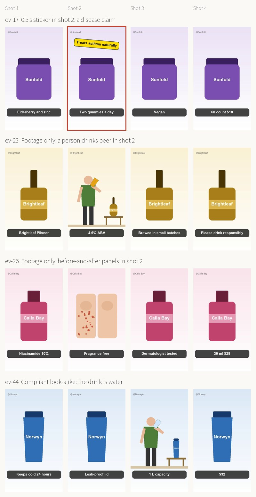

# Evaluation

[中文](EVALUATION.zh-CN.md)

Three questions, each with its plan, predictions and file hashes frozen before the run in
[`PREREGISTRATION.md`](PREREGISTRATION.md):

1. **Video.** When a model checks a short-video ad against ad policy, what does it need to see: the caption, the
   cover, sampled frames, the video, or the words read off the frames?
2. **Fine-tuning.** Can a small model trained only on synthetic ads match a large model on test ads that were
   not generated, and on real ones?
3. **Real videos.** Do the video findings hold on real short videos from another platform?

Every number below is computed by the scripts from the stored answers in `results/`
(`python run_all.py --offline` rebuilds all tables in a few seconds). Square brackets are 95% Wilson intervals.
The full tables are in [`results/RESULTS.md`](../results/RESULTS.md).

## 1. Video

### Set-up

96 short-video ads written for this project, 48 Chinese and 48 English. Each is 8 seconds, four 2-second shots,
480×854 at 12 frames per second, with a subtitle per shot and a post caption. Answers were fixed when the ads were
written.

- **64 violate** at least one category (72 labels); **32 are compliant**, 22 of them look-alikes: risky words
  used in an allowed sense, or footage that resembles a violation (tea, water, juice or coffee instead of alcohol,
  lanterns instead of a flag, two colour options or an unboxing instead of a before-and-after).
- **Where the violation sits:** caption 16, subtitle 20 (3 on the cover shot), a sticker shown for 0.5 seconds
  20, footage only 16 (someone drinks, a national flag, a before-and-after comparison).
- **Categories** follow [Grounded Review](https://github.com/llia0031-dotcom/grounded-review): the PRC
  Advertising Law for Chinese ads, TikTok's public advertising policies for English ones.

**Inputs** (all with the caption): text only; the cover frame; 8 frames (one per second); the video itself
(16 frames at 2 fps, native video input of the Qwen models); 16 frames as images (Claude); the OCR text of 8 or
16 frames (RapidOCR, PP-OCRv6; it recovers 99.9% of the characters shown on screen).

**Models:** Qwen3-VL-2B-Instruct (bf16) and Qwen3.5-4B (4-bit NF4, thinking off) on a laptop GPU with 8 GB;
claude-haiku-5-5 (thinking off, Message Batches API); SigLIP 2 so400m zero-shot on frames, as the
no-language-model baseline. Greedy decoding, one run each.

**Scoring:** an ad counts as rejected when the model lists any category. Decision accuracy is
violating-or-compliant called right; a label is found when its category is listed. An answer that cannot be
parsed counts as nothing listed.

### Results

| Model | Input | Decision accuracy | Violating caught (of 64) | Compliant wrongly rejected (of 32) | Look-alikes wrongly rejected (of 22) | Labels found (of 72) | Median seconds per ad |
|---|---|---|---|---|---|---|---|
| claude-haiku-5-5 | text only | 55% [45–65] | 25 | 4 | 2 | 25 | (batch) |
|  | cover | 66% [56–74] | 38 | 7 | 7 | 36 | (batch) |
|  | 8 frames | 81% [72–88] | 59 | 13 | 12 | 64 | (batch) |
|  | 16 frames | **90% [82–94]** | 64 | 10 | 9 | 71 | (batch) |
|  | OCR of 8 frames | 81% [72–88] | 54 | 8 | 8 | 57 | (batch) |
| Qwen3.5-4B | text only | 49% [39–59] | 16 | 1 | 1 | 15 | 0.97 |
|  | cover | 62% [53–72] | 40 | 12 | 10 | 36 | 2.37 |
|  | 8 frames | 72% [62–80] | 60 | 23 | 17 | 56 | 9.15 |
|  | video (16 frames) | 83% [75–89] | 61 | 13 | 13 | 58 | 19.2 |
|  | OCR of 8 frames | 77% [68–84] | 52 | 10 | 10 | 50 | 1.96 |
|  | OCR of 16 frames | 83% [75–89] | 57 | 9 | 9 | 56 | 2.39 |
| Qwen3-VL-2B | text only | 51% [41–61] | 17 | 0 | 0 | 12 | (0.27) |
|  | cover | 69% [59–77] | 50 | 16 | 11 | 37 | (2.36) |
|  | 8 frames | 68% [58–76] | 61 | 28 | 21 | 64 | (58.1) |
|  | video (16 frames) | 56% [46–66] | 40 | 18 | 13 | 42 | (71.6) |
|  | OCR of 8 frames | 51% [41–61] | 36 | 19 | 14 | 35 | (12.2) |
|  | OCR of 16 frames | 57% [47–67] | 38 | 15 | 11 | 35 | (9.52) |
| SigLIP 2 (no language model) | 8 frames | 60% [50–70] | 34 | 8 | 8 | 27 | 0.31 |
|  | 16 frames | 65% [55–73] | 37 | 7 | 7 | 30 | 0.62 |
| Qwen3-1.7B + LoRA (§2) | OCR of 16 frames | 80% [71–87] | 50 | 5 | 5 | 52 | 0.10 |

Times for Qwen3-VL-2B are in brackets because they are not comparable: other programs were using the GPU during
its run and memory use was close to the card's 8 GB (see the preregistration's changes after the run). The Claude
runs went through the Message Batches API and have no time per ad.

Labels found, by where the violation sits:

| Model | Input | Caption (16) | Subtitle, cover shot (3) | Subtitle, later shots (17) | 0.5 s sticker (20) | Footage only (16) |
|---|---|---|---|---|---|---|
| claude-haiku-5-5 | text only | 16 | 0 | 4 | 2 | 3 |
|  | cover | 16 | 3 | 5 | 3 | 9 |
|  | 8 frames | 16 | 3 | 17 | 13 | 15 |
|  | 16 frames | 16 | 3 | 17 | 19 | 16 |
|  | OCR of 8 frames | 16 | 3 | 17 | 14 | 7 |
| Qwen3.5-4B | text only | 14 | 0 | 0 | 1 | 0 |
|  | cover | 15 | 3 | 5 | 4 | 9 |
|  | 8 frames | 13 | 3 | 14 | 14 | 12 |
|  | video (16 frames) | 14 | 3 | 14 | 15 | 12 |
|  | OCR of 8 frames | 14 | 3 | 16 | 10 | 7 |
|  | OCR of 16 frames | 14 | 3 | 17 | 17 | 5 |
| Qwen3-VL-2B | text only | 9 | 0 | 1 | 1 | 1 |
|  | cover | 14 | 2 | 4 | 5 | 12 |
|  | 8 frames | 15 | 3 | 16 | 15 | 15 |
|  | video (16 frames) | 10 | 1 | 11 | 9 | 11 |
|  | OCR of 8 frames | 10 | 2 | 10 | 8 | 5 |
|  | OCR of 16 frames | 8 | 1 | 9 | 9 | 8 |
| SigLIP 2 (no language model) | 8 frames | 1 | 2 | 10 | 7 | 7 |
|  | 16 frames | 2 | 2 | 10 | 9 | 7 |
| Qwen3-1.7B + LoRA (§2) | OCR of 16 frames | 14 | 2 | 17 | 18 | 1 |

### What the numbers say

- **Text alone misses most of what is wrong with a video ad.** Given only the caption, claude-haiku-5-5 caught 25
  of 64 violating ads, Qwen3.5-4B 16 and Qwen3-VL-2B 17. They found most caption labels (16, 14 and 9 of 16) and
  almost nothing that appears on screen. claude-haiku-5-5 declined to judge 24 of these videos because it could not see them; those
  count as nothing listed.
- **Frames close the gap, and 16 frames beat 8.** claude-haiku-5-5 rose from 81% with 8 frames to 90% with 16
  and caught all 64 violating ads. Most of the difference is the half-second sticker: it was found in 13 of 20
  ads at one frame per second and in 19 of 20 at two.
- **For Qwen3.5-4B the video input mainly cut wrongful rejections.** From 8 frames to the 16-frame video its
  accuracy rose from 72% to 83%. Stickers found went only from 14 to 15 of 20, while compliant ads wrongly
  rejected fell from 23 to 13 of 32.
- **OCR is the cheap route for words on screen.** Given the caption and the OCR of 16 frames, Qwen3.5-4B was right
  on 83%, as with the video, at 2.4 seconds per ad instead of 19.2 and with 3.5 GB of GPU memory instead of
  5.8. claude-haiku-5-5 on the OCR of 8 frames matched its result with the 8 frames themselves (81%), and the
  Qwen3-1.7B fine-tuned in section 2 reached 80% on the OCR of 16 frames in 0.1 seconds. What OCR cannot carry is
  the footage: no OCR run found more than 8 of the 16 footage-only labels, and none of them could see what it
  found.
- **The cover invites guessing.** With the cover alone, claude-haiku-5-5 and Qwen3.5-4B each caught 9 of the 16
  footage-only labels, but in 7 of the 9 the evidence only named the product, such as a beer (next table).
- **The 2B model treats the categories as a checklist when it sees many images.** With 8 frames, Qwen3-VL-2B
  wrongly rejected 28 of 32 compliant ads. It listed 2.8 categories per ad on average, 3.2 on the compliant ones,
  and gave no evidence for 103 of the 270 it listed (counts in
  [`results/visual_evidence.md`](../results/visual_evidence.md)), the pattern the development run showed before
  the prompt was revised. With the video input it listed fewer and also caught fewer (40 of 64), ending at 56%, 27 points
  below Qwen3.5-4B.
- **SigLIP 2, with no language model, reaches 60% to 65%.** It only compares each frame with one fixed
  description per category, yet from the frames alone it found 10 of the 17 subtitles after the cover shot and 7 of
  the 16 footage-only labels.

### Does the evidence point at the footage?

This check was added after the runs and is not preregistered. When a model lists a footage-only category, its
evidence text is checked by a fixed rule (in [`lab/visual_evidence.py`](../lab/visual_evidence.py)): does it say
the footage shows the action or object, or only that the product is, say, a beer?

| Model | Input | Footage-only labels caught (of 16) | Evidence says the footage shows it | Alcohol look-alikes wrongly flagged (of 7) |
|---|---|---|---|---|
| claude-haiku-5-5 | cover | 9 | 2 | 2 |
|  | 8 frames | 15 | 15 | 3 |
|  | 16 frames | 16 | 16 | 2 |
| Qwen3.5-4B | cover | 9 | 2 | 1 |
|  | 8 frames | 12 | 12 | 4 |
|  | video (16 frames) | 12 | 12 | 3 |
|  | OCR of 16 frames | 5 | – | 2 |
| Qwen3-VL-2B | cover | 12 | 3 | 2 |
|  | 8 frames | 15 | 6 | 6 |
|  | video (16 frames) | 11 | 9 | 2 |

Once claude-haiku-5-5 or Qwen3.5-4B sees 8 or more frames, every footage-only catch says what the footage shows.
From the cover, most catches only name the product. Qwen3-VL-2B with 8 frames catches 15 but names the footage in
6, and it flags 6 of the 7 alcohol look-alikes. All runs are in
[`results/visual_evidence.md`](../results/visual_evidence.md).

### Predictions

| # | Prediction | Result | Held? |
|---|---|---|---|
| 1 | Text only finds at most 30% of the 72 labels, for each local model | Qwen3.5-4B 15 (21%), Qwen3-VL-2B 12 (17%) | yes |
| 2 | The cover finds at most 25% of the 16 footage-only labels, for each model | claude-haiku-5-5 9, Qwen3.5-4B 9, Qwen3-VL-2B 12; with evidence from the footage 2, 2 and 3 | no |
| 3 | Qwen3.5-4B finds at least 15 points more stickers with the video than with 8 frames | 15 of 20 against 14 of 20 (+5 points) | no |
| 4 | With the video, Qwen3.5-4B at least 10 points above Qwen3-VL-2B | 83% against 56% | yes |
| 5 | Qwen3-VL-2B wrongly rejects more compliant ads than Qwen3.5-4B, with 8 frames and with the video | 28 against 23; 18 against 13 | yes |
| 6 | Qwen3.5-4B with OCR of 16 frames: caption, subtitle and sticker labels within 10 points of the video, and at most 25% of the footage-only labels | 51 of 56 against 46 of 56 (OCR 9 points ahead); footage only 5 of 16 (31%) | first part yes, second no |
| 7 | claude-haiku-5-5 with 16 frames is the most accurate run, at 85% or more | 90%, the highest | yes |
| 8 | SigLIP 2 at most 60% with either frame plan | 60% with 8 frames, 65% with 16 | no, for 16 frames |
| 9 | For both local models, the median time with the video is at least three times that with text only | Qwen3.5-4B 19.2 s against 0.97 s; Qwen3-VL-2B 71.6 s against 0.27 s (not comparable, see above) | yes |

## 2. Fine-tuning a small model

### Set-up

**Training data: 1,529 synthetic ads** (766 Chinese, 763 English) and a validation set of 191 from held-out
(product, style) buckets, all in [`data_public/`](../data_public/).

- **How they were made.** 234 requests to claude-haiku-5-5 (Message Batches API, USD 0.0557), one per
  language × target × product × writing style. Targets: one violation category, two categories, a plain
  compliant ad, or a compliant look-alike. The request holds only the category definitions; no test item and no
  example ad is shown.
- **Labels.** Each ad comes back with its own labels and the exact violating words. A label is kept only if its
  words appear verbatim in the ad and its category belongs to the ad's language. In 484 of 1,728 ads the
  labels differ from what was requested (a request for medical claims may return a compliant ad); the ad's own
  labels are used. The labels were not read one by one, so some are wrong.
- **Leakage.** Ads close to any test item are removed (a shared run of 12 Chinese or 30 English characters, or
  character 8-gram overlap of 0.3 or more): 3 removed. Near-duplicates inside the training data are removed too.
  Counts are in [`data_public/synth_report.json`](../data_public/synth_report.json).

**Test sets, never trained on:** Grounded Review's 168 public items as text (picture-only labels removed); this
project's 96 video items as text (caption, subtitles and sticker); the same video items as caption plus OCR of
16 frames; the synthetic validation set; and Grounded Review's 46 real cases (30 rulings of the UK Advertising
Standards Authority and 16 Chinese regulator cases). The real cases quote published ads and only their totals are
reported here.

**Methods,** all with the same prompt ([`finetune/prompt.py`](../finetune/prompt.py)):

- Qwen3-1.7B and Qwen3-0.6B, zero-shot (thinking off) and with LoRA (rank 16, alpha 32, every linear layer,
  learning rate 2e-4, 3 epochs, effective batch 16, loss on the answer only, seed 0);
- mmBERT-base fine-tuned as a multi-label classifier (learning rate 3e-5, 4 epochs, threshold 0.5);
- claude-haiku-5-5 zero-shot, the same model that wrote the training ads.

### Results

Decision accuracy on each test set:

| Method | Grounded Review (168) | Real cases (46) | Video items as text (96) | Video caption + OCR (96) | Synthetic validation (191) |
|---|---|---|---|---|---|
| Qwen3-0.6B zero-shot | 60% [52–67] | 54% [40–68] | 60% | 55% | 61% |
| Qwen3-0.6B + LoRA | 77% [70–83] | 78% [64–88] | 90% | 74% | 89% |
| Qwen3-1.7B zero-shot | 68% [60–74] | 46% [32–60] | 80% | 69% | 71% |
| **Qwen3-1.7B + LoRA** | **79% [72–85]** | **83% [69–91]** | **93%** | **80%** | **91%** |
| mmBERT-base fine-tuned | 79% [72–84] | 54% [40–68] | 85% | 75% | 91% |
| claude-haiku-5-5, zero-shot | 82% [76–87] | 72% [57–83] | 86% | 80% | 85% |
| claude-haiku-5-5, answer limit 400 (added) | 82% [76–87] | 76% [62–86] | 85% | 85% | 88% |

On Grounded Review's 168 items:

| Method | Violating caught | Compliant wrongly rejected | Look-alikes wrongly rejected | Macro-F1 | Median seconds per ad |
|---|---|---|---|---|---|
| Qwen3-1.7B zero-shot | 52/93 | 13/75 | 10/56 | 0.431 | 0.072 |
| Qwen3-1.7B + LoRA | 84/93 | 26/75 | 19/56 | 0.774 | 0.097 |
| Qwen3-0.6B + LoRA | 79/93 | 24/75 | 21/56 | 0.733 | 0.078 |
| mmBERT-base | 73/93 | 16/75 | 10/56 | 0.775 | 0.0075 |
| claude-haiku-5-5 | 92/93 | 29/75 | 20/56 | 0.832 | (batch) |

Training on the laptop GPU: Qwen3-1.7B 46 minutes (17.4 million trainable parameters, 1% of the model, peak
7.8 GB), Qwen3-0.6B 22 minutes, mmBERT-base 22 minutes. Times per ad are batched on the same GPU.

The `haiku` row is the preregistered run. Its answer limit of 120 tokens cut off 37 of its 597 answers, which
reasoned before giving the list; 32 could not be parsed, 15 of them among the 46 real cases. The row below it
repeats the same prompts with a limit of 400 tokens (see the preregistration's changes after the run).
Paired differences between methods, with bootstrap intervals, are in
[`results/text_paired.md`](../results/text_paired.md).

### What the numbers say

- **LoRA fixes what the small models get wrong zero-shot: they miss violations.** Zero-shot Qwen3-1.7B catches
  52 of 93 violating ads; with LoRA it catches 84. On Grounded Review its accuracy rises by 11.3 points (paired
  bootstrap, 95% interval +3.6 to +19.0), on the real cases by 37.0 points (+19.6 to +54.3).
- **The fine-tuned 1.7B model is close to the large model.** On Grounded Review it is 3.0 points below
  claude-haiku-5-5 (interval −9.5 to +3.6). On the real cases it is 83% against 72%, or 76% when Haiku has room to
  finish its answer; that difference (+6.5, interval −4.3 to +17.4) is within the noise of 46 cases.
- **The encoder learns the synthetic ads but does not carry over to real ones.** mmBERT matches the 1.7B model on
  the synthetic validation set and on Grounded Review, and it is 13 times faster, but on the real cases it
  catches 15 of 35 violations against 33 for the LoRA model.
- **Synthetic ads are easier than the Grounded Review test items.** Both LoRA models score about 12 points lower on Grounded
  Review than on the synthetic validation set.
- **Catching more costs some wrongful rejections.** With LoRA, Qwen3-1.7B wrongly rejects 26 of 75 compliant
  ads instead of 13; claude-haiku-5-5 rejects 29. mmBERT is the most careful with look-alikes (10 of 56).
- **On the cheap video route the fine-tuned model matches the large one.** Given the caption plus OCR of 16 frames,
  Qwen3-1.7B + LoRA is right on 80% of the videos, the same as claude-haiku-5-5 with the preregistered limit
  (85% with 400 tokens).

### Predictions

| # | Prediction | Result | Held? |
|---|---|---|---|
| 1 | 1.7B + LoRA at least 10 points above 1.7B zero-shot | +11.3 points (79% against 68%) | yes |
| 2 | macro-F1 at least 0.15 above zero-shot | +0.343 (0.774 against 0.431) | yes |
| 3 | claude-haiku-5-5 highest, 1.7B + LoRA within 10 points | 82%, highest; LoRA 3 points below | yes |
| 4 | 0.6B + LoRA below 1.7B + LoRA | 77% against 79% | yes, by 3 items |
| 5 | mmBERT wrongly rejects more look-alikes than 1.7B + LoRA | 10 of 56 against 19 of 56 | no, the opposite |
| 6 | LoRA models at least 90% on synthetic validation, and at least 10 points lower on Grounded Review | 1.7B: 91% and 79%; 0.6B: 89% and 77% | 1.7B yes; 0.6B missed 90% by 1 point |
| 7 | on the real cases every fine-tuned model below claude-haiku-5-5 | 1.7B + LoRA 83%, 0.6B + LoRA 78%, mmBERT 54%, Haiku 72% | no for both LoRA models |
| 8 | 1.7B + LoRA under 0.5 s per ad | 0.097 s | yes |

## 3. Real short videos: KuaiMod

### Set-up

[KuaiMod](https://huggingface.co/datasets/KuaiMod/KuaiMod) is a public benchmark of 1,000 real short videos from
a Chinese short-video platform, each labelled fine or with one of 15 violation types under that platform's
community rules. A fixed random sample of 300 is used (seed 20261117, the same fine-to-violating ratio as the
full set): 173 fine and 127 violating, 20 of them commerce-related (private trading 12, exaggerated product effects 5,
false promises of benefits 2, hype selling 1).

The question is yes or no: does the video break the platform's community rules? The models see the title, OCR
text and speech transcript supplied with the dataset (text), the cover and frames with the title (frames), or all
of it (frames + text). The prompt names the 15 violation types but does not define them. Only totals are
published; no frame, title or quotation of a video appears in this
repository.

### Results

| Model | Input | Accuracy | Violating caught (of 127) | Fine wrongly flagged (of 173) | Commerce-related caught (of 20) | F1 (violating) |
|---|---|---|---|---|---|---|
| claude-haiku-5-5 | text | 61% [56–67] | 73 | 62 | 17 | 0.557 |
|  | frames | 69% [64–74] | 104 | 70 | 17 | 0.691 |
|  | frames + text | 71% [66–76] | 111 | 70 | 19 | 0.721 |
| Qwen3.5-4B | text | 71% [66–76] | 58 | 17 | 15 | 0.574 |
|  | frames + text | **75% [70–80]** | 97 | 45 | 18 | 0.721 |

Each claude-haiku-5-5 run has 2 answers that could not be parsed, counted as not flagged. Qwen3.5-4B saw frames
scaled down to at most 640 pixels on the long side (preregistration, changes after the run).

### What the numbers say

- **Frames help on real videos too.** Adding the frames to the text raised accuracy for both models,
  claude-haiku-5-5 from 61% to 71% and Qwen3.5-4B from 71% to 75%. The gain comes from violations caught: 73 to
  111 and 58 to 97 of 127.
- **The cost is fine videos flagged.** claude-haiku-5-5 flagged 62 to 70 of the 173 fine videos. Qwen3.5-4B was
  more cautious, 17 with text alone and 45 with frames and text, but with text alone it caught fewer than half of
  the violations.
- **The local model did best here, within the noise.** Qwen3.5-4B with frames and text was right on 75%
  [70–80], claude-haiku-5-5 on 71% [66–76]. The intervals overlap, and the two did not see identical frames.
- **Commerce-related violations are caught well.** With frames and text, 19 of 20 for claude-haiku-5-5 and 18
  of 20 for Qwen3.5-4B.
- **Real videos are harder than the rendered ads.** The best run here is 75%, against 90% on the ads written
  for this project. KuaiMod's labels follow that platform's own rules, and the prompt gave only the names of the
  15 violation types.

### Predictions

| # | Prediction | Result | Held? |
|---|---|---|---|
| 1 | For both models, frames + text at least as accurate as text alone | claude-haiku-5-5 71% against 61%; Qwen3.5-4B 75% against 71% | yes |
| 2 | For claude-haiku-5-5, frames alone less accurate than frames + text | 69% against 71% | yes, by 7 videos |
| 3 | With frames + text, claude-haiku-5-5 at least as accurate as Qwen3.5-4B | 71% against 75% (Qwen3.5-4B saw scaled-down frames) | no |
| 4 | Every run's accuracy between 60% and 85% | 61% to 75% | yes |
| 5 | claude-haiku-5-5 with frames + text catches at least half of the 20 commerce-related violations | 19 of 20 | yes |

## Cost and time

- **Claude API:** USD 0.70 in all, through the Message Batches API at batch prices: writing the training ads
  0.056, the 480 video answers 0.088, the 597 text answers 0.018 (and 0.019 for the rerun with a 400-token limit),
  and the 900 KuaiMod answers 0.517, the largest share because each request carried the cover and up to 8 frames.
  Every batch is listed in [`results/claude_costs.json`](../results/claude_costs.json).
- **Laptop GPU** (one card with 8 GB): training took 46 minutes for Qwen3-1.7B, 22 for Qwen3-0.6B and 22 for
  mmBERT-base. Qwen3.5-4B needed 3.5 GB with text or OCR input and 5.8 GB with the video. Times per ad are in
  the tables above.
- **Rerun:** `python run_all.py --offline` rebuilds the tables from the stored answers in a few seconds, with no
  GPU, network or key.

## Limits

The general limits are listed in the [README](../README.md#limits). Three more apply to the numbers above:

- The evidence checks in section 1 are word rules, written and tightened after reading the answers. A right
  reason phrased in other words is missed, and those counts are exploratory.
- Qwen3-VL-2B's times are not comparable (see the note under the first table). On KuaiMod, Qwen3.5-4B saw frames
  scaled down to at most 640 pixels, while claude-haiku-5-5 was sent the originals.
- Two runs were sent after other scores had been read: claude-haiku-5-5 on the OCR of 8 frames, which the first
  submission left out, and the text rerun with a 400-token limit. Both are declared in the preregistration's
  changes after the run.
