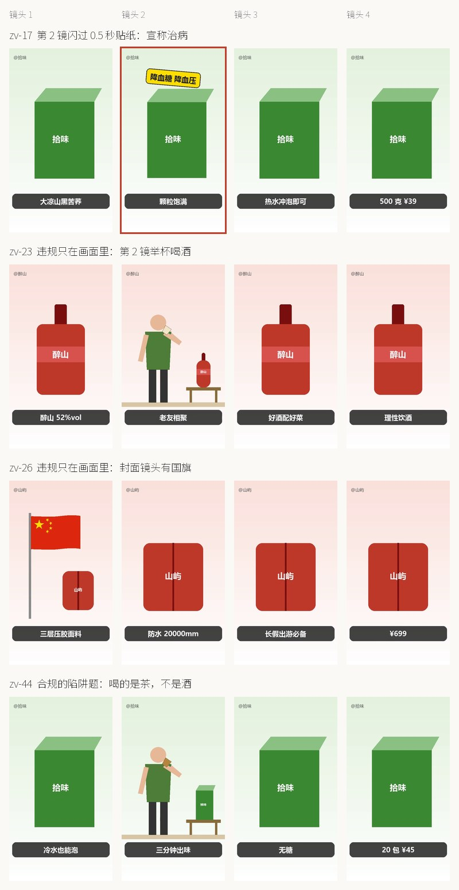

# 评测报告

[English](EVALUATION.md)

三个问题。每个问题的方案、预测和文件哈希都在开跑前写定，见 [`PREREGISTRATION.md`](PREREGISTRATION.md)（英文）：

1. **视频。** 按广告政策审核一条短视频广告，模型要看到什么：发布文案、封面、抽帧、整段视频，还是从画面上识别出的文字？
2. **微调。** 只用合成广告训练的小模型，在不是生成出来的测试广告和真实广告上能不能赶上大模型？
3. **真实视频。** 视频部分的结论，放到另一个平台的真实短视频上还成立吗？

下面每个数字都由脚本从 `results/` 里存下的回答算出（`python run_all.py --offline` 几秒钟就能重算全部表格）。方括号里是 95% Wilson 区间。完整的表在 [`results/RESULTS.md`](../results/RESULTS.md)。

## 1. 视频

### 设置

为这个项目编写的 96 条短视频广告，中英文各 48 条。每条 8 秒，分 4 个 2 秒的镜头，480×854，每秒 12 帧；每个镜头一行字幕，另有一段发布文案。答案在编写广告时就已定好。

- **64 条违规**，至少犯一个类别（共 72 个标签）；**32 条合规**，其中 22 条是“像违规其实合规”的陷阱题：用了有风险的词但意思合规，或者画面像违规（喝的是茶、水、果汁或咖啡而不是酒，挂的是灯笼而不是国旗，展示两种颜色或开箱而不是使用前后对比）。
- **违规出现在哪里：** 发布文案 16 个，字幕 20 个（其中 3 个在封面镜头），只闪现 0.5 秒的贴纸 20 个，只在画面里 16 个（有人喝酒、国旗、使用前后对比）。
- **违规类别**沿用[有据审核](https://github.com/llia0031-dotcom/grounded-review)：中文广告按《中华人民共和国广告法》，英文广告按 TikTok 公开的广告政策。

**输入**（都带发布文案）：只有文字；封面一帧；8 帧（每秒一帧）；视频本身（每秒 2 帧共 16 帧，用 Qwen 模型自带的视频输入）；16 帧图片（Claude）；8 帧或 16 帧上识别出的文字（RapidOCR，PP-OCRv6，能找回画面上 99.9% 的字）。

**模型：** 在 8 GB 笔记本显卡上跑的 Qwen3-VL-2B-Instruct（bf16）和 Qwen3.5-4B（4 位 NF4 量化，关闭思考）；claude-haiku-5-5（关闭思考，走 Message Batches API）；SigLIP 2 so400m 零样本看帧，作为不用语言模型的对照。全部贪心解码，每个模型跑一次。

**怎么打分：** 模型只要列出任何一个类别，就算这条广告被拒。判定准确率是“违规还是合规”判对的比例；一个标签被列出它的类别，就算找到。解析不出的回答算作什么都没列。

### 结果

| 模型 | 输入 | 判定准确率 | 违规抓到（64） | 合规被错拒（32） | 陷阱题被错拒（22） | 找到的标签（72） | 每条用时中位数（秒） |
|---|---|---|---|---|---|---|---|
| claude-haiku-5-5 | 只有文字 | 55% [45–65] | 25 | 4 | 2 | 25 | （批量） |
|  | 封面 | 66% [56–74] | 38 | 7 | 7 | 36 | （批量） |
|  | 8 帧 | 81% [72–88] | 59 | 13 | 12 | 64 | （批量） |
|  | 16 帧 | **90% [82–94]** | 64 | 10 | 9 | 71 | （批量） |
|  | 8 帧识别文字 | 81% [72–88] | 54 | 8 | 8 | 57 | （批量） |
| Qwen3.5-4B | 只有文字 | 49% [39–59] | 16 | 1 | 1 | 15 | 0.97 |
|  | 封面 | 62% [53–72] | 40 | 12 | 10 | 36 | 2.37 |
|  | 8 帧 | 72% [62–80] | 60 | 23 | 17 | 56 | 9.15 |
|  | 视频（16 帧） | 83% [75–89] | 61 | 13 | 13 | 58 | 19.2 |
|  | 8 帧识别文字 | 77% [68–84] | 52 | 10 | 10 | 50 | 1.96 |
|  | 16 帧识别文字 | 83% [75–89] | 57 | 9 | 9 | 56 | 2.39 |
| Qwen3-VL-2B | 只有文字 | 51% [41–61] | 17 | 0 | 0 | 12 | (0.27) |
|  | 封面 | 69% [59–77] | 50 | 16 | 11 | 37 | (2.36) |
|  | 8 帧 | 68% [58–76] | 61 | 28 | 21 | 64 | (58.1) |
|  | 视频（16 帧） | 56% [46–66] | 40 | 18 | 13 | 42 | (71.6) |
|  | 8 帧识别文字 | 51% [41–61] | 36 | 19 | 14 | 35 | (12.2) |
|  | 16 帧识别文字 | 57% [47–67] | 38 | 15 | 11 | 35 | (9.52) |
| SigLIP 2（不用语言模型） | 8 帧 | 60% [50–70] | 34 | 8 | 8 | 27 | 0.31 |
|  | 16 帧 | 65% [55–73] | 37 | 7 | 7 | 30 | 0.62 |
| Qwen3-1.7B + LoRA（第 2 节） | 16 帧识别文字 | 80% [71–87] | 50 | 5 | 5 | 52 | 0.10 |

Qwen3-VL-2B 的用时放在括号里，因为不能和别的结果比：它运行时还有别的程序在用这块显卡，显存用量接近 8 GB 上限（见预注册的“Changes after the run”一节）。Claude 的运行走 Message Batches API，没有每条的用时。

按违规出现的位置，找到的标签数：

| 模型 | 输入 | 发布文案（16） | 封面镜头的字幕（3） | 后面镜头的字幕（17） | 0.5 秒贴纸（20） | 只在画面里（16） |
|---|---|---|---|---|---|---|
| claude-haiku-5-5 | 只有文字 | 16 | 0 | 4 | 2 | 3 |
|  | 封面 | 16 | 3 | 5 | 3 | 9 |
|  | 8 帧 | 16 | 3 | 17 | 13 | 15 |
|  | 16 帧 | 16 | 3 | 17 | 19 | 16 |
|  | 8 帧识别文字 | 16 | 3 | 17 | 14 | 7 |
| Qwen3.5-4B | 只有文字 | 14 | 0 | 0 | 1 | 0 |
|  | 封面 | 15 | 3 | 5 | 4 | 9 |
|  | 8 帧 | 13 | 3 | 14 | 14 | 12 |
|  | 视频（16 帧） | 14 | 3 | 14 | 15 | 12 |
|  | 8 帧识别文字 | 14 | 3 | 16 | 10 | 7 |
|  | 16 帧识别文字 | 14 | 3 | 17 | 17 | 5 |
| Qwen3-VL-2B | 只有文字 | 9 | 0 | 1 | 1 | 1 |
|  | 封面 | 14 | 2 | 4 | 5 | 12 |
|  | 8 帧 | 15 | 3 | 16 | 15 | 15 |
|  | 视频（16 帧） | 10 | 1 | 11 | 9 | 11 |
|  | 8 帧识别文字 | 10 | 2 | 10 | 8 | 5 |
|  | 16 帧识别文字 | 8 | 1 | 9 | 9 | 8 |
| SigLIP 2（不用语言模型） | 8 帧 | 1 | 2 | 10 | 7 | 7 |
|  | 16 帧 | 2 | 2 | 10 | 9 | 7 |
| Qwen3-1.7B + LoRA（第 2 节） | 16 帧识别文字 | 14 | 2 | 17 | 18 | 1 |

### 数字说明了什么

- **只看文字，视频广告的问题大多看不出来。** 只给发布文案时，claude-haiku-5-5 在 64 条违规广告里抓到 25 条，Qwen3.5-4B 抓到 16 条，Qwen3-VL-2B 抓到 17 条。发布文案里的标签大多能找到（16 个里分别找到 16、14、9 个），出现在画面上的几乎都找不到。claude-haiku-5-5 有 24 段视频因为看不到画面而不下判断，这些都算作什么都没列。
- **给了帧，差距就补上了，16 帧比 8 帧好。** claude-haiku-5-5 从 8 帧的 81% 升到 16 帧的 90%，64 条违规广告全部抓到。差别主要来自只出现半秒的贴纸：每秒一帧时 20 条里找到 13 条，每秒两帧时找到 19 条。
- **对 Qwen3.5-4B，视频输入主要是减少了错拒。** 从 8 帧换成 16 帧的视频，准确率从 72% 升到 83%。找到的贴纸只从 14 条变成 15 条，而合规广告被错拒的从 32 条里 23 条降到 13 条。
- **画面上的字，用 OCR 读最省。** 给 Qwen3.5-4B 发布文案加 16 帧的识别文字，判对 83%，和看视频一样；每条只要 2.4 秒而不是 19.2 秒，显存 3.5 GB 而不是 5.8 GB。claude-haiku-5-5 看 8 帧的识别文字，和直接看这 8 帧一样（81%）；第 2 节微调过的 Qwen3-1.7B 看 16 帧的识别文字，判对 80%，每条 0.1 秒。OCR 带不过来的是画面本身：没有一组 OCR 运行在 16 个只在画面里的标签中找到超过 8 个，而且它们都看不到自己找到的东西。
- **只给封面，模型容易猜。** 只看封面时，claude-haiku-5-5 和 Qwen3.5-4B 各在 16 个只在画面里的标签中“找到”9 个，但其中 7 个的理由只是说出了商品，比如这是啤酒（见下表）。
- **2B 模型一看到多张图，就把类别当成清单逐项勾。** 给 8 帧时，Qwen3-VL-2B 在 32 条合规广告里错拒了 28 条。它平均每条广告列出 2.8 个类别，合规广告上是 3.2 个；列出的 270 个类别里有 103 个没给证据（计数见 [`results/visual_evidence.md`](../results/visual_evidence.md)）。开发用题目在修改提示词之前就出现过这种情况。给视频输入时它列得少了，抓到的也少了（64 条里 40 条），最后是 56%，比 Qwen3.5-4B 低 27 个百分点。
- **不用语言模型的 SigLIP 2 能到 60% 到 65%。** 它只是把每一帧和每个类别的一句固定描述比一比，单凭画面也找到了封面之后 17 条字幕里的 10 条、16 个只在画面里的标签里的 7 个。

### 理由指向画面了吗？

这项检查是跑完以后加的，不在预注册里。模型列出“只在画面里”的类别时，用一条固定规则（在 [`lab/visual_evidence.py`](../lab/visual_evidence.py) 里）检查它给的理由：是说画面里出现了这个动作或东西，还是只说商品是啤酒之类？

| 模型 | 输入 | 只在画面里的标签找到（16） | 理由说的是画面里出现了 | 酒类陷阱题被错标（7） |
|---|---|---|---|---|
| claude-haiku-5-5 | 封面 | 9 | 2 | 2 |
|  | 8 帧 | 15 | 15 | 3 |
|  | 16 帧 | 16 | 16 | 2 |
| Qwen3.5-4B | 封面 | 9 | 2 | 1 |
|  | 8 帧 | 12 | 12 | 4 |
|  | 视频（16 帧） | 12 | 12 | 3 |
|  | 16 帧识别文字 | 5 | – | 2 |
| Qwen3-VL-2B | 封面 | 12 | 3 | 2 |
|  | 8 帧 | 15 | 6 | 6 |
|  | 视频（16 帧） | 11 | 9 | 2 |

claude-haiku-5-5 和 Qwen3.5-4B 只要看到 8 帧以上，每个只在画面里的违规都是按画面里出现的内容找到的。只看封面时，大多数只是说出了商品。Qwen3-VL-2B 看 8 帧时找到 15 个，理由提到画面的只有 6 个，7 道酒类陷阱题错标了 6 道。所有运行见 [`results/visual_evidence.md`](../results/visual_evidence.md)。

### 预测

| # | 预测 | 结果 | 成立吗？ |
|---|---|---|---|
| 1 | 只给文字时，每个本机模型最多找到 72 个标签的 30% | Qwen3.5-4B 15 个（21%），Qwen3-VL-2B 12 个（17%） | 成立 |
| 2 | 只给封面时，每个模型最多找到 16 个只在画面里的标签的 25% | claude-haiku-5-5 9 个，Qwen3.5-4B 9 个，Qwen3-VL-2B 12 个；理由来自画面的分别是 2、2、3 个 | 不成立 |
| 3 | Qwen3.5-4B 看视频找到的贴纸比看 8 帧至少多 15 个百分点 | 20 条里 15 条对 14 条（多 5 个百分点） | 不成立 |
| 4 | 看视频时，Qwen3.5-4B 比 Qwen3-VL-2B 至少高 10 个百分点 | 83% 对 56% | 成立 |
| 5 | Qwen3-VL-2B 错拒的合规广告比 Qwen3.5-4B 多，8 帧和视频都是 | 28 条对 23 条；18 条对 13 条 | 成立 |
| 6 | Qwen3.5-4B 看 16 帧识别文字：文案、字幕和贴纸标签与看视频相差不超过 10 个百分点，只在画面里的标签最多找到 25% | 56 个里 51 个对 46 个（OCR 高 9 个百分点）；只在画面里的 16 个里 5 个（31%） | 前半成立，后半不成立 |
| 7 | claude-haiku-5-5 看 16 帧是准确率最高的运行，至少 85% | 90%，最高 | 成立 |
| 8 | SigLIP 2 两种抽帧方式都不超过 60% | 8 帧 60%，16 帧 65% | 16 帧不成立 |
| 9 | 两个本机模型看视频的用时中位数，都至少是只看文字的三倍 | Qwen3.5-4B 19.2 秒对 0.97 秒；Qwen3-VL-2B 71.6 秒对 0.27 秒（不能比，见上文） | 成立 |

## 2. 微调小模型

### 设置

**训练数据：1,529 条合成广告**（中文 766 条，英文 763 条），另有 191 条验证广告，取自没有用来训练的（商品，写法）组合。都在 [`data_public/`](../data_public/) 里。

- **怎么生成。** 向 claude-haiku-5-5 发了 234 个请求（Message Batches API，0.0557 美元），每个请求对应一种语言 × 目标 × 商品 × 写法。目标有四种：犯一个违规类别、犯两个类别、普通的合规广告、像违规其实合规的广告。请求里只有类别定义，没有给任何测试题，也没有给示例广告。
- **标签。** 每条广告和它自己的标签、违规原话一起返回。只有违规原话在广告里逐字出现、类别也属于这种语言时，才保留这个标签。1,728 条广告里有 484 条的标签和请求的不一样（比如要求写医疗宣称，返回的却是合规广告），这时用广告自己的标签。标签没有逐条读过，所以有些是错的。
- **防止泄漏。** 和任何测试题相近的广告都删掉（中文连续 12 个字、英文连续 30 个字符相同，或字符 8-gram 重合度达到 0.3）：删了 3 条。训练数据内部的近似重复也删掉了。数字见 [`data_public/synth_report.json`](../data_public/synth_report.json)。

**测试集，都没有用来训练：** 有据审核的 168 道公开题目，按文字给（去掉只在图片里的标签）；本项目的 96 条视频题，按文字给（发布文案、字幕和贴纸）；同样的视频题，给发布文案加 16 帧的识别文字；合成验证集；有据审核的 46 个真实案例（英国广告标准局 30 份裁决，中国监管部门 16 个案例）。真实案例引用了公开发布过的广告，这里只报汇总数字。

**方法**，都用同一个提示词（[`finetune/prompt.py`](../finetune/prompt.py)）：

- Qwen3-1.7B 和 Qwen3-0.6B，零样本（关闭思考）和加 LoRA（rank 16，alpha 32，所有线性层，学习率 2e-4，3 轮，等效批大小 16，只在答案上算损失，随机种子 0）；
- mmBERT-base 微调成多标签分类器（学习率 3e-5，4 轮，阈值 0.5）；
- claude-haiku-5-5 零样本，也就是写训练广告的那个模型。

### 结果

各测试集上的判定准确率：

| 方法 | 有据审核（168） | 真实案例（46） | 视频题按文字（96） | 视频文案加识别文字（96） | 合成验证集（191） |
|---|---|---|---|---|---|
| Qwen3-0.6B 零样本 | 60% [52–67] | 54% [40–68] | 60% | 55% | 61% |
| Qwen3-0.6B + LoRA | 77% [70–83] | 78% [64–88] | 90% | 74% | 89% |
| Qwen3-1.7B 零样本 | 68% [60–74] | 46% [32–60] | 80% | 69% | 71% |
| **Qwen3-1.7B + LoRA** | **79% [72–85]** | **83% [69–91]** | **93%** | **80%** | **91%** |
| mmBERT-base 微调 | 79% [72–84] | 54% [40–68] | 85% | 75% | 91% |
| claude-haiku-5-5 零样本 | 82% [76–87] | 72% [57–83] | 86% | 80% | 85% |
| claude-haiku-5-5，回答上限 400（后加） | 82% [76–87] | 76% [62–86] | 85% | 85% | 88% |

有据审核 168 道题上：

| 方法 | 违规抓到 | 合规被错拒 | 陷阱题被错拒 | Macro-F1 | 每条广告用时中位数（秒） |
|---|---|---|---|---|---|
| Qwen3-1.7B 零样本 | 52/93 | 13/75 | 10/56 | 0.431 | 0.072 |
| Qwen3-1.7B + LoRA | 84/93 | 26/75 | 19/56 | 0.774 | 0.097 |
| Qwen3-0.6B + LoRA | 79/93 | 24/75 | 21/56 | 0.733 | 0.078 |
| mmBERT-base | 73/93 | 16/75 | 10/56 | 0.775 | 0.0075 |
| claude-haiku-5-5 | 92/93 | 29/75 | 20/56 | 0.832 | （批量） |

在笔记本显卡上训练：Qwen3-1.7B 用了 46 分钟（可训练参数 1,740 万，占模型 1%，显存峰值 7.8 GB），Qwen3-0.6B 22 分钟，mmBERT-base 22 分钟。每条广告的用时是在同一块显卡上成批预测算出的。

`haiku` 一行是预注册的那次运行。它的回答上限是 120 个 token，597 条回答里有 37 条先写理由再给列表，被截断了；32 条解析不出，其中 15 条在 46 个真实案例里。下面一行用同样的提示词，把上限放到 400 个 token 重跑（见预注册的“Changes after the run”一节）。方法之间的配对差值和 bootstrap 区间见 [`results/text_paired.md`](../results/text_paired.md)。

### 数字说明了什么

- **小模型零样本的问题是漏判，LoRA 正好补上。** 零样本的 Qwen3-1.7B 在 93 条违规广告里只抓到 52 条，加 LoRA 后抓到 84 条。在有据审核上准确率提高 11.3 个百分点（配对 bootstrap，95% 区间 +3.6 到 +19.0），在真实案例上提高 37.0 个百分点（+19.6 到 +54.3）。
- **微调后的 1.7B 模型接近大模型。** 在有据审核上比 claude-haiku-5-5 低 3.0 个百分点（区间 −9.5 到 +3.6）。在真实案例上是 83% 对 72%；给 Haiku 足够的长度写完回答时是 76%，这个差距（+6.5，区间 −4.3 到 +17.4）在 46 个案例的误差范围内。
- **编码器模型学会了合成广告，却没能用到真实广告上。** mmBERT 在合成验证集和有据审核上和 1.7B 模型持平，速度快 13 倍；但在真实案例的 35 条违规里只抓到 15 条，LoRA 模型抓到 33 条。
- **合成广告比有据审核的测试题容易。** 两个 LoRA 模型在有据审核上的分数都比合成验证集低 12 个百分点左右。
- **抓得多，错拒也多一些。** 加 LoRA 后，Qwen3-1.7B 在 75 条合规广告里错拒 26 条，原来是 13 条；claude-haiku-5-5 错拒 29 条。对陷阱题最谨慎的是 mmBERT（56 条里错拒 10 条）。
- **走便宜的视频路线时，微调模型赶得上大模型。** 只给发布文案加 16 帧的识别文字，Qwen3-1.7B + LoRA 判对 80% 的视频，和预注册上限下的 claude-haiku-5-5 一样（上限 400 时是 85%）。

### 预测

| # | 预测 | 结果 | 成立吗？ |
|---|---|---|---|
| 1 | 1.7B + LoRA 比 1.7B 零样本至少高 10 个百分点 | 高 11.3 个百分点（79% 对 68%） | 成立 |
| 2 | Macro-F1 比零样本至少高 0.15 | 高 0.343（0.774 对 0.431） | 成立 |
| 3 | claude-haiku-5-5 最高，1.7B + LoRA 差距在 10 个百分点以内 | 82%，最高；LoRA 低 3 个百分点 | 成立 |
| 4 | 0.6B + LoRA 低于 1.7B + LoRA | 77% 对 79% | 成立，差 3 道题 |
| 5 | mmBERT 错拒的陷阱题比 1.7B + LoRA 多 | 56 条里 10 条对 19 条 | 不成立，正好相反 |
| 6 | LoRA 模型在合成验证集上至少 90%，在有据审核上至少低 10 个百分点 | 1.7B：91% 和 79%；0.6B：89% 和 77% | 1.7B 成立；0.6B 差 1 个百分点没到 90% |
| 7 | 在真实案例上，每个微调模型都低于 claude-haiku-5-5 | 1.7B + LoRA 83%，0.6B + LoRA 78%，mmBERT 54%，Haiku 72% | 两个 LoRA 模型都不成立 |
| 8 | 1.7B + LoRA 每条广告不到 0.5 秒 | 0.097 秒 | 成立 |

## 3. 真实短视频：KuaiMod

### 设置

[KuaiMod](https://huggingface.co/datasets/KuaiMod/KuaiMod) 是一个公开基准，收了一个中文短视频平台的 1,000 条真实短视频，每条按该平台的社区规范标为正常，或 15 种违规类型之一。这里用固定的随机样本 300 条（随机种子 20261117，正常和违规的比例与全集相同）：正常 173 条，违规 127 条，其中 20 条和带货有关（引导私下交易 12 条、夸大商品功效 5 条、虚假承诺福利 2 条、炒作卖货 1 条）。

问题只有“是”或“否”：这条视频违反平台的社区规范吗？模型看到的是数据集自带的标题、画面识别文字和语音转写（文字），或者封面和抽帧加标题（画面），或者全部（画面 + 文字）。提示词里列出 15 种违规类型的名称，没有给定义。只公开汇总数字，仓库里没有任何一帧画面、标题或视频里的原话。

### 结果

| 模型 | 输入 | 准确率 | 违规抓到（127） | 正常视频被错标（173） | 带货相关违规抓到（20） | F1（违规类） |
|---|---|---|---|---|---|---|
| claude-haiku-5-5 | 文字 | 61% [56–67] | 73 | 62 | 17 | 0.557 |
|  | 画面 | 69% [64–74] | 104 | 70 | 17 | 0.691 |
|  | 画面 + 文字 | 71% [66–76] | 111 | 70 | 19 | 0.721 |
| Qwen3.5-4B | 文字 | 71% [66–76] | 58 | 17 | 15 | 0.574 |
|  | 画面 + 文字 | **75% [70–80]** | 97 | 45 | 18 | 0.721 |

claude-haiku-5-5 每组各有 2 条回答解析不出，算作没有标违规。Qwen3.5-4B 看到的帧缩到了长边最多 640 像素（见预注册的“Changes after the run”一节）。

### 数字说明了什么

- **真实视频上，画面也有用。** 文字之外再给画面，两个模型的准确率都提高了：claude-haiku-5-5 从 61% 到 71%，Qwen3.5-4B 从 71% 到 75%。提高来自抓到的违规：127 条里分别从 73 条到 111 条、从 58 条到 97 条。
- **代价是正常视频被标成违规。** claude-haiku-5-5 在 173 条正常视频里标错 62 到 70 条。Qwen3.5-4B 谨慎一些，只给文字时 17 条、画面加文字时 45 条，但只给文字时它抓到的违规不到一半。
- **这一节本机模型最好，但差距在误差范围内。** Qwen3.5-4B 看画面加文字判对 75% [70–80]，claude-haiku-5-5 判对 71% [66–76]。两个区间有重叠，而且两者看到的帧不完全一样。
- **带货相关的违规抓得好。** 画面加文字时，claude-haiku-5-5 在 20 条里抓到 19 条，Qwen3.5-4B 抓到 18 条。
- **真实视频比渲染的广告难。** 这里最好的一组是 75%，在本项目编写的广告上是 90%。KuaiMod 的标签按那个平台自己的规则定，提示词里只给了 15 种违规类型的名称。

### 预测

| # | 预测 | 结果 | 成立吗？ |
|---|---|---|---|
| 1 | 两个模型都是画面加文字不低于只给文字 | claude-haiku-5-5 71% 对 61%；Qwen3.5-4B 75% 对 71% | 成立 |
| 2 | claude-haiku-5-5 只看画面低于画面加文字 | 69% 对 71% | 成立，差 7 条视频 |
| 3 | 画面加文字时，claude-haiku-5-5 不低于 Qwen3.5-4B | 71% 对 75%（Qwen3.5-4B 看的是缩小的帧） | 不成立 |
| 4 | 每组准确率都在 60% 到 85% 之间 | 61% 到 75% | 成立 |
| 5 | claude-haiku-5-5 画面加文字时，20 条带货相关违规至少抓到一半 | 20 条里 19 条 | 成立 |

## 费用和用时

- **Claude 接口：** 一共 0.70 美元，全部走 Message Batches API，按批量价格计：生成训练广告 0.056，480 条视频回答 0.088，597 条文字回答 0.018（上限 400 的重跑另花 0.019），900 条 KuaiMod 回答 0.517。KuaiMod 花得最多，因为每个请求都带着封面和最多 8 帧。每一批的明细见 [`results/claude_costs.json`](../results/claude_costs.json)。
- **笔记本显卡**（一块 8 GB 的卡）：训练 Qwen3-1.7B 用了 46 分钟，Qwen3-0.6B 22 分钟，mmBERT-base 22 分钟。Qwen3.5-4B 给文字或识别文字时用 3.5 GB 显存，看视频时用 5.8 GB。每条的用时见上面的表。
- **重算：** `python run_all.py --offline` 用存下的回答几秒钟就能重算所有表格，不需要显卡、网络和密钥。

## 局限

通用的局限列在 [README](../README.zh-CN.md#局限) 里。上面的数字还有三点要注意：

- 第 1 节对理由的检查是按词的规则，是读过回答以后写的，又收紧过。换一种说法的正确理由会被漏掉，这些计数只作探索。
- Qwen3-VL-2B 的用时不能比（见第一张表下面的说明）。在 KuaiMod 上，Qwen3.5-4B 看到的帧缩到了长边最多 640 像素，claude-haiku-5-5 收到的是原图。
- 有两组是在看过其他成绩以后才发出的：claude-haiku-5-5 看 8 帧识别文字那组（第一次提交时漏了），以及回答上限 400 的文字重跑。两组都写在预注册的“Changes after the run”一节里。
